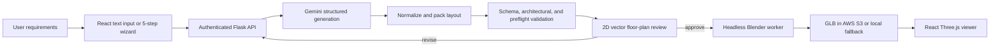

# ArchiGen Project Progress and Thesis Handoff

**Snapshot date:** 14 October 2026  
**Repository branch:** `akbar`  
**Base commit:** `f370f64` (`improve 2d layout generation`)  
**Snapshot note:** The working tree also contains substantial uncommitted architectural-pipeline, Blender, asset-catalog, and viewer changes. Commit or back up this work before major refactoring.

## 1. Executive summary

ArchiGen is a final-year project that converts a user's residential design requirements into a validated 2D architectural floor plan and then into an interactive, furnished 3D house model.

The current repository contains a functional end-to-end prototype:

1. A user can register or log in.
2. The user can create a project and describe a house through text or a five-step requirements wizard.
3. The backend asks Google Gemini to produce structured architectural data.
4. A deterministic layout, normalization, repair, and validation pipeline converts the result into the project's canonical Architectural JSON Schema v3.0.
5. The user reviews a vector/CAD-style 2D floor plan.
6. Approval triggers a headless Blender worker, which generates a textured and furnished GLB model.
7. The GLB is stored through AWS S3 when configured, or served locally as a fallback.
8. The React/Three.js frontend loads the result and provides multiple viewing and walkthrough modes.

This is best described as a **working integrated prototype**, not a finished architectural product. The largest remaining areas are fine-grained editing, complete exterior design, much broader 3D asset coverage, end-to-end reliability/testing, and deployment/security hardening.

ArchiGen is a design-assistance and visualization system. Its generated plans have computational checks, but they must not be represented as certified construction drawings or as a replacement for a licensed architect, structural engineer, or local building-code review.

## 2. Problem statement

Traditional residential design normally requires multiple manual stages: collecting client requirements, drawing a floor plan, checking spatial constraints, creating a 3D model, furnishing the scene, and revising the design after feedback. This process requires specialist software and can be slow for non-technical users.

ArchiGen investigates whether natural-language AI, deterministic spatial algorithms, procedural 3D generation, and browser-based visualization can be combined into one workflow that produces an understandable residential concept quickly while preserving structured data and basic geometric validity.

## 3. Project objectives

The practical objectives represented by the current system are:

- Collect plot, room, style, material, budget, furniture, and special-feature requirements.
- Convert natural-language requirements into structured architectural JSON.
- Produce deterministic room placement within a plot and support multiple floors.
- Represent rooms, walls, doors, windows, stairs, furniture, materials, site, and roof information in one canonical schema.
- Detect or repair common problems such as overlaps, invalid references, out-of-bounds furniture, and opening conflicts.
- Require human approval of the 2D plan before expensive 3D generation.
- Procedurally construct the approved design in headless Blender.
- Export a web-compatible GLB and visualize it interactively in the browser.
- Save projects and design versions so users can compare or refine results.

## 4. Current end-to-end workflow

An important design choice is the approval gate: generation initially returns a 2D design with `layout_approved = false`; Blender synthesis begins only after approval, although a manual retry endpoint is also available.

### Progress-at-a-glance matrix

| Work area | Current status | What that status means |
|---|---|---|
| Authentication | Implemented prototype | Registration, login, password hashing, JWT checks, and user-scoped data are present |
| Projects and versions | Implemented prototype | CRUD, version listing, base-version refinement, and saved GLB references are present |
| Requirements wizard | Implemented prototype | Five-step collection and prompt construction are present |
| AI design generation | Implemented prototype | Gemini request, structured parsing, error handling, and normalization are present |
| Canonical layout/schema | Implemented prototype | Shared schema, deterministic layout engine, coordinate conversion, and multi-floor data are present |
| Validation and repair | Implemented and unit-tested | Schema, reported architectural checks, preflight repair, approval blocking, and regression tests are present |
| 2D plan review | Implemented prototype | Multi-floor SVG/CAD display, pan/zoom, dimensions, selection, and approval are present |
| Fine-grained editing | Partial | Backend update/validation and stale-GLB invalidation exist; the direct-manipulation editor and history remain |
| Blender generation | Implemented prototype | Geometry, openings, stairs, materials, furniture, inventory checks, and GLB export are present |
| Browser 3D viewer | Implemented prototype | GLB loading, view modes, room navigation, floors, roof, lighting, and walkthrough are present |
| Exterior design | Partial | Preferences and some procedural site/roof/material behavior exist; complete style-aware facades remain |
| Asset library | Partial | Core assets exist, but many types have zero or one usable variant |
| Cloud/deployment pipeline | Partial | MongoDB, S3 helpers, worker endpoints, Docker/Gunicorn configuration exist; production hardening and live verification remain |
| Automated quality assurance | Partial | Architectural unit tests and a Blender integration runner exist; API, UI, cloud, and full E2E coverage remain |

## 5. System architecture

| Layer | Main technology | Responsibility |
|---|---|---|
| Frontend | React 18, Vite, Zustand, Axios | Authentication UI, project/version management, requirements wizard, 2D review, generation status, and application state |
| 2D/3D visualization | SVG, Three.js, React Three Fiber, Drei | CAD-style floor-plan display, GLB loading, camera modes, room navigation, lighting, and walkthrough |
| Backend API | Flask, Gunicorn, Flask-CORS | Authentication, project/version APIs, AI orchestration, validation, approval, and Blender-worker calls |
| AI generation | Gemini 2.5 Flash by default | Converts requirements and broader revision prompts into structured design JSON |
| Deterministic architecture pipeline | Python, JSON Schema | Constraint extraction, room packing, canonicalization, repair, and validation |
| Persistence | MongoDB | Users, projects, versions, and legacy design/history records |
| 3D worker | Blender 4.x Python in headless mode | Geometry, openings, stairs, materials, furniture placement, lighting, and GLB export |
| Model storage | AWS S3, with local serving fallback | Generated models and optional on-demand asset synchronization |

### Main directories

- [`frontend/`](frontend/) — React application and browser viewers.
- [`backend/`](backend/) — Flask API, database/authentication, AI integration, layout engine, schema, validation, and Blender adapter.
- [`blender/`](blender/) — headless worker, procedural generator, importer/exporter, assets, and metadata.
- [`backend/tests/`](backend/tests/) — architectural unit/regression tests and the Blender integration matrix.

## 6. Implemented functionality

### 6.1 Authentication and data ownership

- Registration and login APIs are implemented.
- Passwords are hashed with bcrypt.
- JWT authentication protects project, version, layout, and generation routes.
- Backend queries scope projects and versions to the authenticated user.
- The frontend stores the current JWT/session, rejects expired tokens, and clears project state on logout.

### 6.2 Project and version management

- Create, list, open, rename, and delete projects.
- List and open versions belonging to a project.
- Create a new version from a selected/base version.
- Preserve version number, prompt, style, creation time, approval state, and GLB URL.
- Poll the backend while approved 3D generation is running.
- Retry 3D generation for a version.
- Open a previously generated cloud GLB without rerunning Blender; regeneration is an explicit forced action.
- Legacy flat-design routes are retained for backward compatibility.

### 6.3 Requirements collection

Users can provide a free-text description or use a five-step wizard:

1. Plot details: width, length, feet/meters, floor count, building type, orientation, road access, coverage, and setbacks.
2. Room configuration: room type, count, size, floor, location preference, attached bathroom, and notes.
3. Design preferences: architectural style, roof, exterior color/material, interior style, floor finish, furnishing level, design priority, and budget.
4. Extra features: gardens, boundary wall, entrance gate, parking, pool, roof terrace, balcony, outdoor seating, exterior lighting, solar panels, storage/laundry, and servant quarters.
5. Review and generation.

The UI currently exposes up to four floors and common residential room types, including bedrooms, bathrooms, kitchen, living/drawing/dining rooms, garage, balcony, study/prayer rooms, service rooms, garden, and terrace.

### 6.4 AI and deterministic layout generation

- Prompts are checked for architectural relevance before AI generation.
- The AI is instructed to return structured JSON rather than presentation-only text.
- The parser handles JSON extraction and limited response repair and reports truncated/invalid responses.
- A deterministic layout engine packs rooms into plot bounds and builds a multi-floor layout.
- Prompt constraint extraction recognizes requested room connections.
- Broader refinements can use the previous design as context.
- A limited targeted refinement path can safely modify a requested bedroom window without mutating the saved base version.
- Generation is designed to be deterministic after normalization for the same structured input.

### 6.5 Canonical Architectural JSON Schema v3.0

The schema is intended to be the single source of truth for 2D, Blender, and Three.js. It contains:

- project name, unit, style, and orientation;
- plot, road, setbacks, and site features;
- building footprint, floor count, floor height, and wall thickness;
- floor levels and elevations;
- rooms with positions, dimensions, types, materials, and relationships;
- canonical walls and their connected rooms;
- doors and windows tied to room and wall IDs;
- furniture instances with asset identifiers, position, rotation, and dimensions;
- stairs, roof, exterior data, and validation information.

Internal geometry is normalized to meters. Conversion helpers for feet and meters are included.

### 6.6 Validation and repair

There are three complementary validation layers:

- JSON Schema validation checks document structure and required data.
- `ArchitecturalValidator` produces a reported 20-check architectural assessment.
- Preflight validation performs deterministic safe repairs and blocks critical conflicts before approval or 3D generation.

Implemented checks/repairs cover plot and building bounds, room overlaps and minimum dimensions, floor count, vertical/stair alignment, door accessibility, window placement, coordinate sanity, furniture containment/collisions, door clearance, roof alignment, and missing core room types. Openings are associated with canonical wall IDs, and doors/windows sharing a wall can be separated. Furniture is repositioned inside its assigned room where safe.

These checks are geometric/application rules, not comprehensive national or municipal building-code validation.

### 6.7 2D floor-plan review

- SVG-based CAD-style floor-plan rendering.
- Multi-floor selection.
- Rooms, wall network, doors, windows, stairs, dimensions, labels, plot boundary, and orientation display.
- Zoom and pan controls and selected-room highlighting.
- Approval interface that starts 3D synthesis.
- Backend endpoints exist to update a layout and retrieve its validation report.

The current viewer is mainly a review surface. It does **not yet provide the complete fine-grained editing experience** described in the remaining-work section.

### 6.8 Blender 3D generation

- Converts canonical design data into a Blender-specific layout without dropping required inventory.
- Builds foundations/patios, room slabs, canonical walls, and multi-floor elevations.
- Creates door and window cut-outs and inserts models or generated frames/glass fallbacks.
- Uses only canonical approved openings when a wall network is present, preventing inferred duplicate doors.
- Normalizes imported asset origins so doors, windows, gates, and furniture remain centred and floor-seated after GLB export.
- Uses a sectional shutter for garage openings and the catalogued `Gate.glb` model for the exterior entrance gate.
- Builds procedural staircases between floors.
- Applies PBR-style materials and UV tiling for floors, walls, grounds, and other surfaces.
- Imports, normalizes, scales, rotates, and places catalog furniture.
- Uses diagnostic placeholders when an asset is missing or fails to load.
- Sets up environmental lighting.
- Verifies expected furniture/opening inventory before export.
- Exports a self-contained web-ready GLB.
- Can resolve missing local assets from S3 and can synchronize the wider asset tree.

The worker exposes health, model-serving, generation, and asset-sync endpoints. When S3 is not configured, generated models can be served from the worker's local model route.

### 6.9 Browser 3D experience

- Loads the generated Blender GLB with progress and error/retry states.
- Plan, dollhouse, walkthrough, and roof viewing modes.
- Orbit, pan, zoom, reset, and fullscreen controls.
- First-person WASD walkthrough with mouse look and basic room/door collision constraints.
- Room navigator that moves the camera to a selected room.
- Roof visibility toggle and multi-floor filtering/cutaway support.
- Day/night environment modes.
- Displays design statistics such as rooms, doors, windows, style, and dimensions.
- A separate gallery previews the currently published browser-ready model assets.

## 7. API summary

All paths below use the `/api` prefix except the Blender worker endpoints.

| Area | Methods/routes | Purpose |
|---|---|---|
| Authentication | `POST /auth/register`, `POST /auth/login` | Create account and obtain JWT |
| Projects | `GET/POST /projects`, `GET/PATCH/PUT/DELETE /projects/:id` | Project CRUD |
| Versions | `GET /projects/:id/versions`, `GET /versions/:id`, `POST /projects/:id/generate` | Version retrieval and AI generation/refinement |
| Layout | `PATCH /projects/:pid/versions/:vid/layout`, `GET .../validation` | Save structured edits and rerun validation |
| Approval/3D | `POST .../approve-layout`, `POST .../generate-3d` | Approval-triggered asynchronous generation or manual retry |
| Legacy | `POST /chat`, `GET /history`, `GET /design/:id` | Compatibility with the earlier flat design model |
| Blender worker | `GET /health`, `POST /generate`, `GET /models/:file`, `POST /sync-assets` | Headless generation, result serving, and asset synchronization |

## 8. Current asset inventory

The asset tree contains many planned category folders, but a folder containing only `.gitkeep` is not an implemented asset category.

| Asset group | Current files | Notes |
|---|---:|---|
| Bathroom furniture | 3 GLB | Bathtub, sink, toilet |
| Bedroom furniture | 6 GLB | Two beds plus bedside table, desk, armchair, and cabinet |
| Dining-room furniture | 3 GLB | Table, chair, sideboard |
| Kitchen furniture/appliances | 5 GLB | Cabinet, island, refrigerator, sink, microwave |
| Living-room furniture | 4 GLB + 1 GLTF | Armchair, coffee table, lamp, cabinet, and sofa; the GLTF is not copied into the public GLB gallery |
| Doors | 3 GLB | Standard variants only |
| Windows | 3 GLB | Standard variants only |
| Surface textures | 9 JPG | 3 floor, 2 ground, and 4 wall textures |
| Browser gallery | 21 GLB | Mirrors current GLB furniture assets |
| Metadata | 23 JSON files | Includes the metadata schema plus individual asset records |

The raw count is useful, but coverage is uneven. Several planned subtypes have no model, and some assets are reused across room categories. The asset catalog documentation describes the intended hierarchy more broadly than the files currently present.

## 9. Verification status at this snapshot

### Checks run on 14 October 2026

- Backend automated tests: **PASS** — 9 test methods, including saved-model reuse and explicit forced regeneration.
- Those methods exercise five main layout scenarios: small one-bed/one-bath, multiple bedrooms/bathrooms, narrow corridor, varied furniture orientations, and multi-floor stairs.
- Regression coverage also includes same-wall opening separation, safe resizing on a crowded front wall, integrated kitchen fixtures, deterministic output, metric plot preservation, requested room connections, targeted bedroom-window refinement, cloud-model reuse, and forced replacement.
- Frontend production build: **PASS** — Vite transformed 2,538 modules and produced the production bundle.
- Exact reported five-room model: **PASS** — Blender 5.1 generated and exported the GLB with 6 canonical doors, 5 correctly oriented windows, a grounded entrance gate, an in-room bedroom wardrobe, and roof geometry contained within the building footprint.
- The corrected five-room GLB was uploaded to S3 and linked to version `6aceb5f936e0616f930107d4`; the previous S3 object remains available for recovery.

### Warnings and unverified areas

- The EC2 Blender worker must be rebuilt/restarted with the current repository before future regenerations; the reported version already uses the separately verified corrected S3 GLB.
- The production JavaScript bundle is about 1.42 MB before gzip (about 402 KB gzip), and Vite reports a chunk-size warning. Code splitting is recommended.
- Browser compatibility metadata (`caniuse-lite`) is reported as outdated.
- An eight-scenario headless Blender integration runner exists, covering single/multi-floor, same-wall openings, varied furniture, wide plots, and deterministic repeat. The full matrix was not rerun while preparing this handoff, but the exact five-room visual-regression case was generated, exported, and audited successfully.
- There is no automated frontend component/end-to-end test suite in `package.json`.
- Authentication, MongoDB behavior, S3, live Gemini calls, API error paths, and deployed worker behavior are not covered by the nine unit tests.

## 10. Remaining work and recommended acceptance criteria

### Priority 1 — Fine-grained editing

This is the most important product gap. Build a real editor on top of the existing canonical schema and layout-update endpoint.

Minimum scope:

- Select, add, duplicate, and remove rooms.
- Drag rooms and resize them with handles.
- Snap to grid and adjacent walls while preserving valid boundaries.
- Add, move, resize, and delete doors/windows on a selected wall.
- Move, rotate, replace, and delete furniture.
- Change room materials, wall finish, flooring, and colors.
- Display validation errors at the affected object rather than only as a general report.
- Add undo/redo, cancel, reset, and explicit save.
- Revalidate after each committed change and prevent approval while critical errors remain.
- Support responsive mouse/touch behavior and keyboard accessibility.

Critical data rule: any saved geometry/material edit to an approved version must revoke approval, clear the stale `approved_at` and `glb_url`, and require approval/regeneration again. The backend now enforces this invalidation; the future editor must preserve that behavior.

Suggested completion test: a user can generate a plan, resize a bedroom, move its window, rotate a bed, change its flooring, resolve any shown conflict, save, approve, and receive a new GLB that matches the edited 2D plan.

### Priority 2 — Exterior design

The wizard collects exterior choices, and the schema/generator already has partial site, roof, patio, wall-material, ground, and gate concepts. A coherent facade/exterior system is still required.

Minimum scope:

- Implement style-aware facades for the supported architectural styles.
- Complete roof types, parapets, fascia, gutters, and roof material choices.
- Add main entrance treatment, facade depth, balconies, terraces, railings, columns, shading, and exterior trims.
- Add boundary walls, gates, driveway/parking, paths, gardens/landscaping, pool, exterior lights, and optional solar panels.
- Make front elevation respect plot orientation and road access.
- Ensure exterior selections flow from wizard → schema → Blender → GLB rather than remaining UI-only preferences.
- Add front/side/back elevation views or saved screenshots for evaluation.

Suggested completion test: two plans with identical interiors but different exterior styles produce visibly distinct, correctly oriented facades without changing the approved room geometry.

### Priority 3 — Expand and standardize the asset library

The target should be **at least 2–3 validated variants for every asset type exposed by the generator/UI**, not merely 2–3 files per broad room folder.

Recommended core coverage:

- Living room: sofas, armchairs, coffee tables, side tables, TV/media units, shelving, lamps.
- Bedroom: single/double/king beds, bedside tables, wardrobes, dressers, desks/vanities, chairs.
- Dining: 4/6/8-seat tables, individual chairs, sideboards/bar units.
- Kitchen: base/upper/tall cabinets, islands, counters, stools, sink, refrigerator, stove/oven, microwave.
- Bathroom: toilet, sink/vanity, shower, bathtub, storage, mirrors and fixtures.
- Office/study, entryway, laundry, kids' room, garage, prayer room, and outdoor furniture.
- Architecture: interior/exterior/sliding doors, standard/large/sliding windows, gates, railings, stairs, columns, facade panels, and roof details.
- Materials: multiple wall, floor, ceiling, tile, wood, stone, metal, fabric, glass, ground, and roof materials.

Every asset should pass an ingestion checklist:

1. Use GLB/glTF 2.0, real-world meter scale, bottom-centered pivot, correct forward direction, and applied transforms.
2. Stay within an agreed polygon/texture budget and load without external missing files.
3. Include metadata: ID, category/subtype, dimensions, style tags, supported rooms, model path, license, source URL, author, and attribution requirements.
4. Have a unique filename/ID and a preview thumbnail.
5. Be tested for Blender import, automatic placement, collision footprint, GLB export, S3 sync, and browser rendering.
6. Use only assets whose licenses permit the project's use and redistribution; keep an attribution/license register for the thesis appendix.

Also convert or correctly package the living-room sofa GLTF so that it participates in the same self-contained GLB pipeline and gallery as the other assets.

### Priority 4 — Reliability and test coverage

- Run and record all eight Blender integration scenarios on the target Blender version.
- Add test fixtures for malformed AI output, impossible plots, dense furniture, missing assets, multi-floor alignment, approval, retry, and stale-model invalidation.
- Add Flask API tests with an isolated test database and mocked Gemini/Blender/S3 services.
- Add frontend unit/component tests and Playwright or Cypress end-to-end tests.
- Add a golden-scene comparison or inventory report to prove the 2D JSON and exported GLB contain the same rooms/openings/furniture.
- Add performance measurements for AI response time, layout time, Blender generation time, GLB size, and browser load/FPS.
- Add structured job states (`queued`, `running`, `succeeded`, `failed`) and surface worker errors. A production task queue is safer than a daemon thread inside the API process.

### Priority 5 — Security, configuration, and deployment hardening

- Remove the tracked default MongoDB URI containing embedded credentials from `backend/config.py`; rotate any credential that has ever been valid and require environment configuration.
- Remove the development JWT-secret fallback in production.
- Restrict CORS to known frontend origins rather than `*`.
- Add input-size limits, rate limiting, stronger validation, centralized error logging, and production-safe logs.
- Define S3 bucket privacy/CORS and presigned-URL behavior consistently.
- Protect the Blender worker so arbitrary public clients cannot start expensive jobs or request unsafe paths.
- Add worker timeouts, concurrency limits, cleanup, retries, monitoring, and health reporting.
- Decide and document the actual deployment topology. Current code supports Flask/Gunicorn, a separately hosted Blender worker (local or AWS EC2/ECS), MongoDB, and AWS S3; do not reuse older documentation that mentions FastAPI or Google Cloud Storage.

### Priority 6 — Documentation and maintainability

- Replace the template frontend README with ArchiGen setup instructions.
- Update the Blender README and asset catalog to match the implemented Flask/AWS architecture and actual asset counts.
- Add an environment-variable template without secrets.
- Document local development, Blender version, deployment, backup/recovery, and troubleshooting.
- Consolidate duplicate/fallback viewer and furniture-builder code where practical.
- Add API documentation and schema examples generated from a known-good design.

## 11. Suggested delivery plan

| Milestone | Main deliverable | Exit criterion |
|---|---|---|
| M1: Stabilize | Commit current work, configuration hardening, updated docs, full baseline test record | Clean reproducible setup and no tracked secrets |
| M2: Editor | Room/opening/furniture/material editing with undo and validation | Edited plan persists and invalidates stale approval/GLB |
| M3: Asset expansion | 2–3 validated variants for each supported core asset type | Automated catalog audit and no missing core-room assets |
| M4: Exterior | Style-aware facade, roof, site and outdoor features | Wizard choices visibly and consistently affect exported GLB |
| M5: Quality | API, UI, end-to-end, and complete Blender integration tests | Recorded repeatable pass on the target deployment |
| M6: Evaluation and thesis | Experiments, user study, results, screenshots, diagrams, final writing | Evidence answers research questions and limitations are explicit |

## 12. Thesis/report writing guide

### Proposed title

**ArchiGen: An AI-Assisted Pipeline for Generating Validated Residential Floor Plans and Interactive 3D Models**

### Possible research questions

1. How effectively can natural-language residential requirements be transformed into schema-valid and geometrically consistent floor plans?
2. Can a shared canonical architectural representation preserve consistency from AI output through 2D review to procedural 3D generation?
3. How much time does the automated workflow save compared with manual concept modeling for the selected test cases?
4. How usable and understandable is the generated 2D/3D output for non-expert users?

### Main technical contribution to emphasize

The strongest contribution is not simply “using AI to draw a house.” It is the hybrid pipeline:

- AI interprets ambiguous user intent.
- A canonical JSON schema provides a shared representation.
- Deterministic algorithms normalize, pack, repair, and validate geometry.
- Human approval controls the transition from plan to 3D.
- Blender procedurally produces the final scene.
- A browser viewer makes the output interactive.

This division is important because unrestricted generative output alone cannot guarantee spatial consistency. The project combines probabilistic requirement interpretation with deterministic geometric safeguards.

### Recommended thesis chapters

1. **Introduction** — background, problem, motivation, aims, scope, research questions, and contributions.
2. **Literature review** — generative AI for design, text-to-layout, constraint-based floor planning, BIM/parametric modeling, procedural Blender generation, glTF/GLB, and web 3D visualization.
3. **Requirements and methodology** — functional/non-functional requirements, iterative development process, chosen residential scope, and evaluation design.
4. **System design** — architecture diagram, data flow, database/version model, canonical schema, approval state, asset pipeline, and security model.
5. **Implementation** — wizard and prompt creation, Gemini integration, layout engine, validation/repair, Blender geometry and assets, S3 pipeline, and Three.js viewer.
6. **Testing and evaluation** — unit/integration/end-to-end cases, geometric validity, reliability, timings, GLB size/performance, and user evaluation.
7. **Results and discussion** — what worked, comparison across plots/styles, failure cases, trade-offs between AI freedom and deterministic rules, and threat to validity.
8. **Conclusion and future work** — answer research questions and discuss fine editing, exterior sophistication, asset scale, code compliance, and future BIM/export options.

### Evidence to collect before final submission

- Screenshots of every wizard stage and the project/version interface.
- The same example shown as requirements, canonical JSON, 2D plan, Blender scene, and browser GLB.
- Single-floor, multi-floor, narrow-plot, wide-plot, and dense-room examples.
- Before/after examples of preflight repair and user refinement.
- Exterior-style comparisons after exterior work is complete.
- Asset coverage table with source/license records.
- Test results with date, environment, Blender version, and commit hash.
- Timing table: AI, layout/validation, Blender, upload, download, and first render.
- Output quality metrics: schema success, critical-error rate, overlap count, request satisfaction, generation success, GLB size, and browser FPS.
- A small usability study using task completion, completion time, error count, and a standard questionnaire such as SUS, with participant consent and anonymization.
- Honest failure cases, including impossible requests, AI schema failures, missing assets, and poor facade or furniture choices.

### Suggested evaluation matrix

| Dimension | Example measure |
|---|---|
| Requirement satisfaction | Requested rooms/features present ÷ requested rooms/features |
| Structural data quality | Schema-valid generations ÷ total generations |
| Geometric quality | Critical preflight errors, overlaps, out-of-bounds objects |
| Cross-stage consistency | Matching IDs/counts in canonical JSON and exported GLB inventory |
| Reliability | Successful end-to-end runs ÷ attempts across the scenario matrix |
| Performance | Median and 95th-percentile time for AI, Blender, and initial model load |
| Web performance | GLB size, loading time, average FPS, peak memory on target device |
| Usability | Task completion, time-on-task, user errors, SUS score, qualitative themes |

## 13. Known limitations and risks

- Generated designs are conceptual and do not prove structural safety or legal code compliance.
- AI output can be incomplete, inconsistent, or unavailable; normalization reduces but cannot eliminate this risk.
- Fine-grained manual editing is not complete.
- Exterior choices are richer in the wizard/catalog plan than in the finished generator output.
- Asset variety is too limited for consistently distinct interiors, and missing assets can become placeholders.
- A daemon background thread is not a durable production job queue; jobs may be lost when the API process restarts.
- S3/private URL expiration and CORS must be managed carefully for saved versions.
- The current frontend bundle is large and may perform poorly on low-end/mobile devices.
- Existing documentation has architecture drift; code currently uses Flask and AWS S3 even where older text mentions FastAPI or GCS.
- Current automated evidence is strongest for the geometry pipeline and weaker for API, browser, cloud, and user-level behavior.

## 14. Important source files for the next developer/writer

- [`backend/routes/chat.py`](backend/routes/chat.py) — projects, versions, generation, approval, layout update, and validation APIs.
- [`backend/utils/gemini.py`](backend/utils/gemini.py) and [`backend/utils/gemini_layout.py`](backend/utils/gemini_layout.py) — AI calls, prompts, parsing, normalization, constraints, and layout processing.
- [`backend/utils/architectural_schema_v3.py`](backend/utils/architectural_schema_v3.py) — canonical schema and architectural constants.
- [`backend/utils/layout_engine.py`](backend/utils/layout_engine.py) — deterministic room layout and coordinate conversion.
- [`backend/utils/architectural_preflight.py`](backend/utils/architectural_preflight.py) — safe repairs and critical-error detection.
- [`backend/utils/architectural_validator.py`](backend/utils/architectural_validator.py) — reported architectural checks.
- [`backend/utils/architectural_refinement.py`](backend/utils/architectural_refinement.py) — limited direct refinement behavior.
- [`backend/utils/blender_service.py`](backend/utils/blender_service.py) — canonical-to-worker adapter and worker request.
- [`blender/scripts/generate_house.py`](blender/scripts/generate_house.py) — procedural scene generation.
- [`blender/scripts/place_furniture.py`](blender/scripts/place_furniture.py) — catalog lookup and placement.
- [`blender/worker_server.py`](blender/worker_server.py) — deployed/local Blender worker API and S3 upload.
- [`frontend/src/components/home-wizard/`](frontend/src/components/home-wizard/) — structured requirements wizard.
- [`frontend/src/components/FloorPlanVectorViewer.jsx`](frontend/src/components/FloorPlanVectorViewer.jsx) — 2D plan review.
- [`frontend/src/components/viewer3d/`](frontend/src/components/viewer3d/) — GLB viewer, modes, movement, room navigation, and overlays.
- [`frontend/src/store/useProjectStore.js`](frontend/src/store/useProjectStore.js) — project/version/generation frontend workflow.
- [`backend/tests/test_architectural_pipeline.py`](backend/tests/test_architectural_pipeline.py) — current unit/regression evidence.
- [`backend/tests/run_blender_integration.py`](backend/tests/run_blender_integration.py) — eight-case Blender integration runner.

## 15. Short progress-report paragraph

> ArchiGen has reached an integrated prototype stage. The system supports authenticated projects and version history, structured requirement collection, Gemini-assisted architectural JSON generation, deterministic floor-plan normalization, schema and geometric validation, user approval of an SVG-based 2D plan, and procedural generation of a furnished GLB house through a headless Blender worker. Generated models can be stored in AWS S3 and explored in a React/Three.js viewer with dollhouse, roof, multi-floor, room-navigation, and first-person walkthrough modes. Current automated architectural tests and the frontend production build pass. The next phase will focus on fine-grained plan and furniture editing, complete facade/exterior generation, expansion of the licensed asset library to at least two or three variants per supported asset type, full Blender/API/UI testing, and production security and deployment hardening.

## 16. Terminology consistency for the report

Use these terms consistently:

- **ArchiGen** — project/product name.
- **Canonical architectural design** — validated JSON Schema v3.0 data shared across stages.
- **2D floor plan** — browser SVG/CAD-style representation of the canonical design.
- **Blender worker** — separate headless service that converts a canonical design into GLB.
- **GLB** — binary glTF output loaded by the browser.
- **Design version** — immutable design lineage entry created by generation/refinement. Fine editing needs a clearly defined save/version policy before completion.
- **Validation/repair** — application-level geometric safeguards, not professional code certification.
