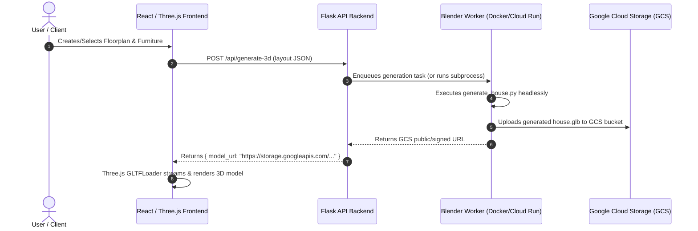

# ArchGen - Blender 3D Architecture Generation Subsystem

Welcome to the **ArchGen Blender 3D Subsystem**. This standalone module is responsible for procedural 3D house generation, architectural floorplan conversion, intelligent furniture placement, and web-ready 3D model export (`.glb`).

---

## 1. System Purpose

In the ArchGen Final Year Project (FYP), user-designed or AI-suggested 2D floorplans and room configurations are converted into fully-textured, realistic 3D architectural models. 

This Blender subsystem:
1. **Parses Architectural Layouts**: Ingests JSON files describing room dimensions, walls, doors, windows, and required furniture.
2. **Procedurally Builds House Geometry**: Generates foundation slabs, wall meshes, flooring, and openings using Blender's Python API (`bpy`).
3. **Places Furniture & Fixtures**: Looks up furniture metadata and instantiates 3D assets into designated rooms at specified coordinates and orientations.
4. **Exports Web-Ready 3D Assets**: Generates compressed, standardized `.glb` files ready for real-time visualization in the React / Three.js frontend.

---

## 2. Directory Structure

> 💡 **Full 3D Model Catalog**: See [blender/assets/CATALOG.md](assets/CATALOG.md) for the complete list of 28 existing models, 96 asset folders, dimensions, and specifications for all rooms.

```
blender/
├── assets/                     # 3D assets, materials, and decorations
│   ├── architecture/           # Walls, ceiling designs, stairs, columns, doors, windows
│   ├── furniture/              # Living room, kitchen, bathroom, bedroom, dining, office, etc.
│   ├── decorations/            # Wall art, mirrors, curtains, rugs, plants, tabletop decor
│   ├── lighting/               # Ceiling chandeliers, wall sconces, lamps, LED strip cove
│   ├── appliances/             # Kitchen appliances, laundry units, televisions
│   ├── fixtures/               # Plumbing faucets, shower heads, hardware, bath accessories
│   ├── textures/               # Floors, walls, tiles, ceilings, fabrics, woods, marbles
│   └── CATALOG.md              # Comprehensive 3D Model Catalog & Specifications
│
├── scripts/                    # Headless Blender Python scripts
│   ├── generate_house.py       # Main generator: walls, slabs, openings, assembly
│   ├── place_furniture.py      # Furniture catalog lookup and room arrangement
│   ├── import_asset.py         # 3D asset importer, pivot normalizer, metadata tagger
│   ├── export_glb.py           # Optimized glTF/GLB export for Three.js
│   ├── generate_metadata.py    # Auto-generates JSON metadata for catalog
│   └── sync_s3_assets.py       # Cloud asset sync utility (AWS S3)
│
├── input/                      # Floorplan JSON specifications from backend
├── output/                     # Generated .glb models and test renders
├── metadata/                   # JSON schemas and asset metadata definitions
├── Dockerfile                  # Headless Blender worker container
└── README.md                   # System documentation & integration architecture
```

---

## 3. Supported 3D Model Formats & Standards

| Format | Extension | Status | Notes |
| :--- | :--- | :--- | :--- |
| **glTF 2.0 Binary** | `.glb` | **Primary / Strongly Recommended** | Self-contained textures, fast loading, direct Three.js compatibility |
| **glTF 2.0 Text** | `.gltf` + `.bin` | Supported | Multi-file format, good for inspecting scene graphs |
| **Wavefront OBJ** | `.obj` + `.mtl` | Supported (Import only) | Legacy format; lacks modern PBR material standards |
| **Autodesk FBX** | `.fbx` | Supported (Import only) | Good for rigged or complex assets |
| **Blender Project** | `.blend` | Staging / Library only | Not recommended as runtime asset format |

### Asset Modeling Guidelines for Three.js:
- **Units**: 1 Blender Unit = 1 Meter.
- **Pivot Origin**: Model pivot point should be centered horizontally at the **base/bottom** ($Z = 0$) for easy floor snapping.
- **Polygon Budget**: Low to medium poly ($1,000$ to $25,000$ triangles per furniture item).
- **Materials**: Standard PBR (Metallic-Roughness) workflow.
- **Textures**: $1024 \times 1024$ or $2048 \times 2048$ PNG/JPG/WebP embedded directly inside `.glb`.

---

## 4. How to Manually Add a Furniture Asset

Follow these 3 simple steps to add any new 3D model to the ArchGen catalog:

### Step 1: Obtain or Create a GLB Model
Download or export a CC0 / open-source 3D model (e.g., from [Poly Haven](https://polyhaven.com), [ambientCG](https://ambientcg.com), or Blender export). Ensure it is named uniquely in snake_case (e.g., `modern_dining_table_001.glb`).

### Step 2: Place the File in the Appropriate Room Folder
Move your `.glb` file to its corresponding room directory:
```
blender/assets/furniture/dining_room/modern_dining_table_001.glb
```

### Step 3: Create the Accompanying Metadata JSON
Create a matching JSON file in `blender/metadata/` (or alongside the asset) adhering to `furniture.schema.json`:

`blender/metadata/modern_dining_table_001.json`:
```json
{
  "id": "modern_dining_table_001",
  "name": "Oak Dining Table 6-Seater",
  "category": "dining_table",
  "room": "dining_room",
  "style": ["modern", "scandinavian"],
  "width": 1.8,
  "depth": 0.9,
  "height": 0.76,
  "model_file": "assets/furniture/dining_room/modern_dining_table_001.glb",
  "format": "glb",
  "license": "CC0",
  "source": "Poly Haven",
  "source_url": "https://polyhaven.com/a/wooden_table_02",
  "author": "Poly Haven Artist",
  "tags": ["table", "dining", "wood", "oak", "scandinavian"]
}
```

---

## 5. Running Blender Locally (CLI / Headless)

You can run the generator locally with your installed Blender executable:

### Windows (PowerShell):
```powershell
# Run headless house generation
& "C:\Program Files\Blender Foundation\Blender 4.2\blender.exe" --background --python blender/scripts/generate_house.py -- --input blender/input/sample_house_layout.json --output blender/output/my_house.glb
```

### Linux / macOS:
```bash
blender --background --python blender/scripts/generate_house.py -- \
        --input blender/input/sample_house_layout.json \
        --output blender/output/my_house.glb
```

### Upload changed Blender scripts to S3

The focused uploader compares local script content with S3 and uploads only new or changed `.py` files. Normal scripts are stored below `s3://$AWS_S3_BUCKET/assets/scripts/`. The root `blender/worker_server.py` file can be selected with `worker_server.py` in `--files` and is stored separately at `s3://$AWS_S3_BUCKET/assets/worker_server.py`.

```powershell
# Preview changes without uploading
python blender/scripts/upload_s3_scripts.py --dry-run

# Upload new or changed scripts
python blender/scripts/upload_s3_scripts.py

# Upload only selected scripts, including the worker server
python blender/scripts/upload_s3_scripts.py --files generate_house.py import_asset.py worker_server.py
```

AWS configuration is read from the current environment and then from `backend/gem_api.env` for missing values. Use `--force` to upload selected files without comparing them with S3.

After downloading an updated `worker_server.py`, the `/sync-assets` response sets `restart_required` to `true`. Restart the worker container to activate that file. When enabling worker-server sync on an existing worker for the first time, call `/sync-assets` twice: the first call installs the updated sync script, and the second places `worker_server.py` in `/app/blender/worker_server.py`.

For timeout checks, captured Blender errors, missing glTF dependencies, and EC2
update commands, see [worker troubleshooting](../docs/blender-worker-troubleshooting.md).

---

## 6. Headless Docker Execution

The included `blender/Dockerfile` builds an Ubuntu 22.04 container pre-configured with headless Blender and software OpenGL rendering (Mesa).

### Build the Docker Image:
```bash
docker build -t archgen-blender-worker -f blender/Dockerfile ./blender
```

### Run Generation in Docker:
```bash
docker run --rm \
  -v $(pwd)/blender/input:/app/blender/input \
  -v $(pwd)/blender/output:/app/blender/output \
  archgen-blender-worker
```

---

## 7. Future Integration Roadmap (Backend, GCS, Frontend)



### 1. Connecting to the Backend (`backend/`):
- The Flask backend will expose an endpoint (e.g., `POST /api/v1/generate-3d`).
- When called, the backend validates the user's floorplan, writes an ephemeral JSON input file, and invokes the Blender worker via `subprocess` (locally) or enqueues a job to a task queue (Celery / Cloud Tasks / PubSub).

### 2. Google Cloud Storage (GCS) Asset Pipeline:
- **Furniture Asset Sync**: The 3D furniture catalog assets are stored in a GCS bucket (e.g., `gs://archgen-assets/furniture/`). The worker container downloads or caches required models on demand.
- **Output Storage**: When `export_glb.py` produces the final `house_<id>.glb`, the worker uploads it to `gs://archgen-generated-models/<user_id>/<house_id>.glb` and generates a signed URL.

### 3. React / Three.js Frontend Rendering:
- The React frontend uses `@react-three/fiber` and `@react-three/drei` (or vanilla Three.js `GLTFLoader`).
- The frontend fetches the `.glb` from the backend URL and mounts it inside an interactive 3D canvas with orbit controls, lighting, and first-person walkthrough mode.
